<p align="center">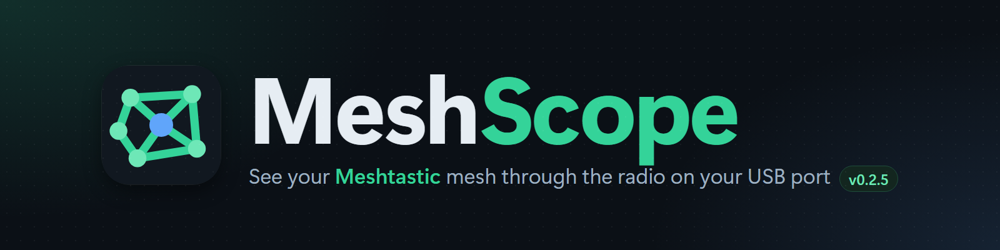</p>

A Windows desktop app for exploring a Meshtastic mesh through a radio connected over USB.

## Features

_Screenshots: version 0.2.5, Night theme, demo mode._

- **Nodes**: every node seen, with hops, SNR, last heard, distance, battery, hardware and role. Search, sort and filter. Star **favorites** and keep them on top, or show only favorites.
- **Actions** on any node: **traceroute**, **ping**, **request node info**, plus request position and request telemetry. Any hop limit from 1 to 7.

<p align="center">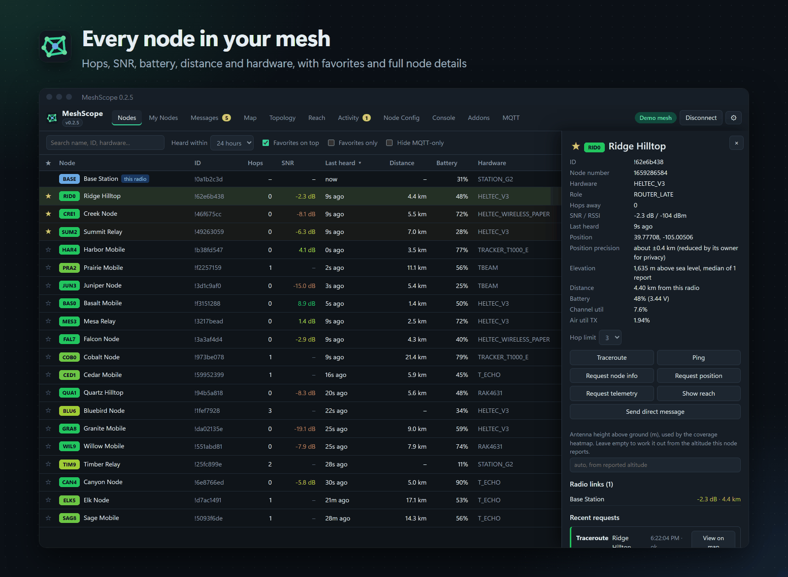</p>

- **My Nodes**: radios you have connected to are remembered by node ID, not COM port. MeshScope finds them again on whatever port Windows assigns, can connect one automatically at startup, and reconnects it if it's unplugged and plugged back in. Each radio keeps its own mesh history: switching radios shows only that radio's nodes, messages, requests and activity, and switching back restores them.

<p align="center">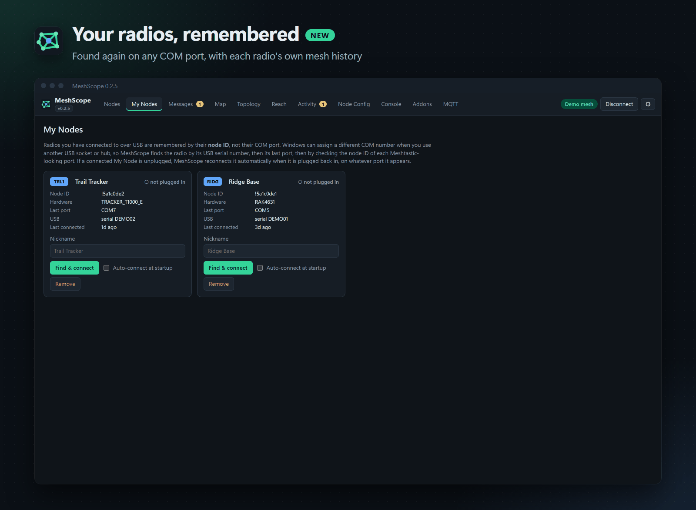</p>

- **Messages**: the radio's channels, switching between them, sending messages on a channel or as a direct message, and delivery status (heard by a neighbour / delivered / failed). A message is marked **via MQTT** only if it reached MeshScope solely through the MQTT bridge. Select a message to **Reply** (quoted) or **React** with an emoji.

<p align="center">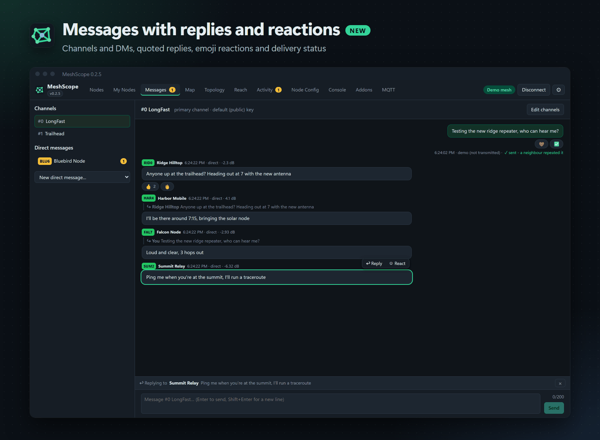</p>

- **Map**: nodes with GPS positions, and the radio links between them coloured by SNR (Street, Topographic and Satellite layers). Hovering a node opens an info bubble; move into it to use its buttons, or click to pin it. **Live** animates packets along the path they most likely took as they're received.

<p align="center">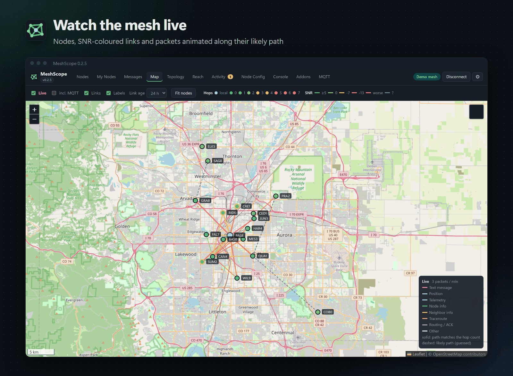</p>

- **Traceroute view**: **View on map** on any finished traceroute draws the route towards the target and back in two colours, with SNR for every hop.

<p align="center">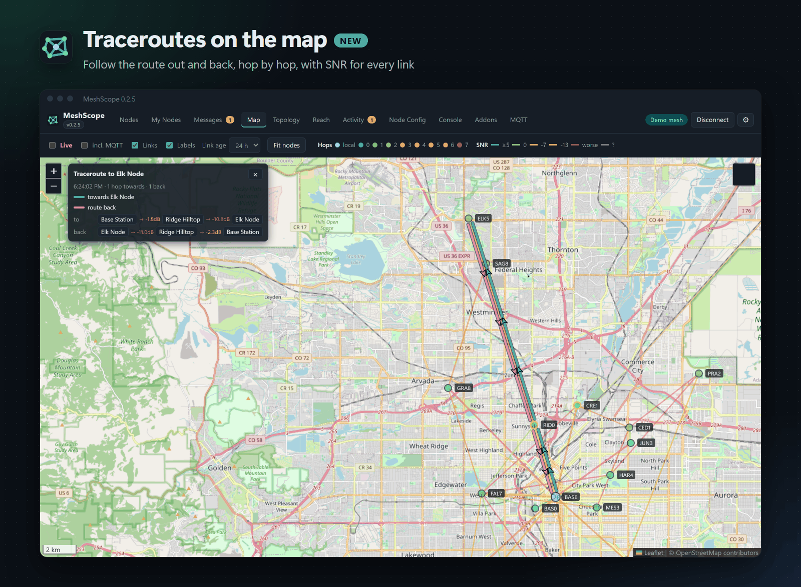</p>

- **Topology**: a force-directed graph of the local mesh. It also shows nodes that have no GPS position, and has the same **Live** animation.

<p align="center">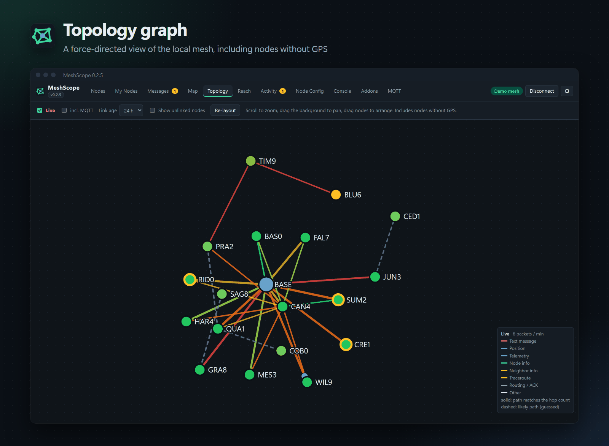</p>

- **Reach**: pick any node and a hop limit. MeshScope floods outward over the observed links, the same way Meshtastic rebroadcasts a packet. It shows which nodes the message reaches at each hop, the coverage footprint, the farthest node reached and the nodes just past the hop limit.

<p align="center">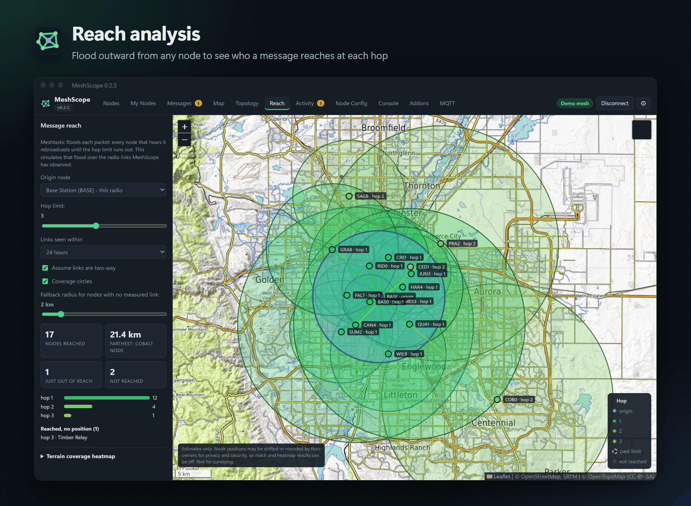</p>

- **Terrain heatmap** (in Reach): predicted signal margin around one or more nodes, using real elevation data (hills and valleys shadow the signal), per-node antenna height (towers, rooftops) and an environment loss for buildings and trees.

<p align="center">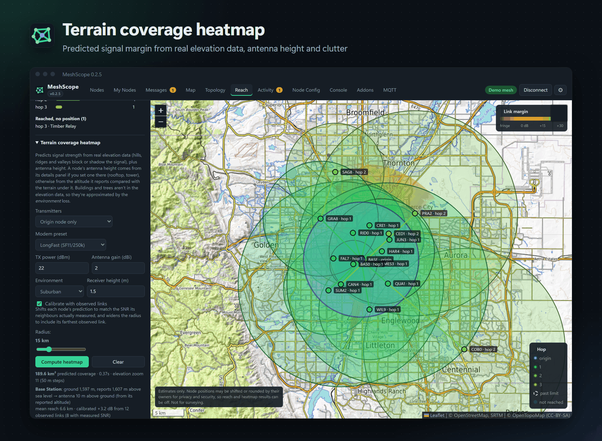</p>

- **Activity**: request results, including full traceroute paths with SNR for each hop in both directions, and a live packet log.

<p align="center">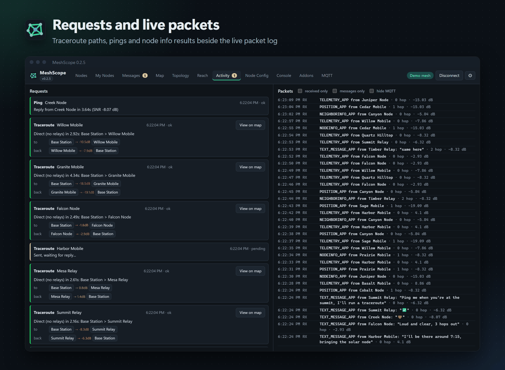</p>

- **MQTT**: subscribe to a Meshtastic MQTT broker for wider, real-time data. Optional uplink publishes only broadcasts your radio heard over the air that the sender marked OK-to-MQTT and that no other gateway has already published; nothing received from MQTT is ever published back.

<p align="center">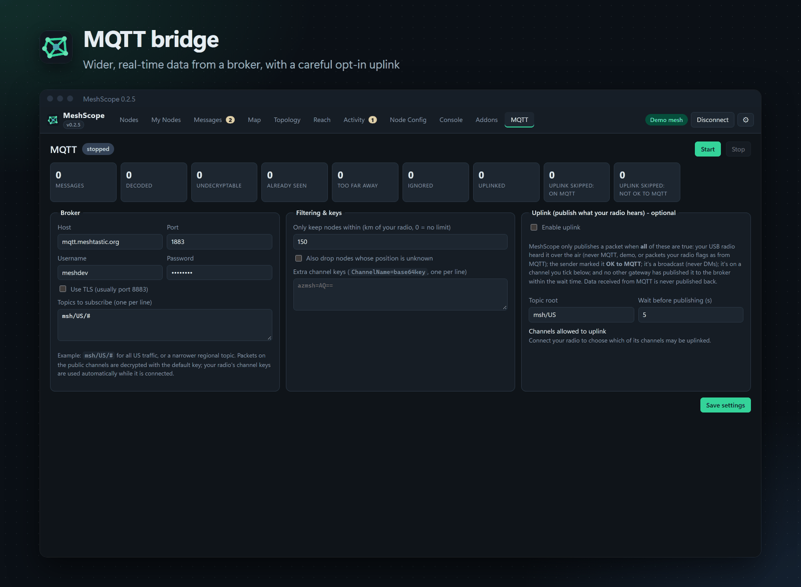</p>

- **Node Config**: view and edit every setting of the connected radio (owner, channels and keys, radio config, modules). Every change saves a backup first. Back up on demand, download or import backups, and restore one to the radio. Backups use the `meshtastic --export-config` YAML format.
- **Console**: run `meshtastic` CLI commands (`--info`, `--get`, `--set`, ...) on the connected radio, with the device's debug log alongside. Commands that reboot or wipe the radio ask first.
- **Addons**: Python scripts that receive every inbound packet and can log, alert, store data or act (send messages, run traceroutes). Create from templates, edit in the app, enable/disable, and import or export them singly or as a `.zip`. See the **[addon guide](docs/ADDONS.md)** to write your own.
- **Demo mode**: a simulated mesh for trying the app without a radio.

## Install

Run `dist\MeshScope-<version>-setup.exe` (or the plain `dist\MeshScope-<version>-win64.msi`, the same installer without the MeshScope icon). It installs to `Program Files\MeshScope` and adds Start-menu and desktop shortcuts. Python and the VC++ runtime are bundled in the installer.

The UI opens in a Microsoft Edge app window, so it has no browser tabs or address bar. Edge ships with Windows 10 and 11. The map tiles need an internet connection; everything else works offline.

## Using it

1. Plug the radio in over USB. If Windows doesn't create a COM port, install the USB driver for its chip: CP210x for many ESP32 boards, or CH9102/CH340 for others. Nordic nRF52 and ESP32-S3 boards use the built-in driver.
2. Close any other program that is using the port, such as the Meshtastic web client, the Python CLI or a serial monitor.
3. Pick the port (likely Meshtastic devices are starred) and click **Connect**.

### How links are discovered
Each link is a direct radio hop that was actually observed. MeshScope learns them from several sources:

| Source | Meaning |
|---|---|
| `nodedb` / `direct` | Your radio heard the node with zero hops used |
| `traceroute` | Each hop in a traceroute reply, with SNR in both directions |
| `neighborinfo` | A node's NeighborInfo broadcast listing the nodes it hears |
| `relay` | Inferred from the `relay_node` byte of multi-hop packets (shown dashed) |

Traceroutes are the best way to fill in the map and the reach analysis. Enabling the NeighborInfo module on your nodes also helps.

### Notes on the actions
- **Ping**: Meshtastic has no ICMP. MeshScope sends a small want-ACK packet on the private app port and times the destination's routing ACK. "Implicit ACK" means a neighbour was heard repeating the packet, but the destination never confirmed it.
- **Traceroute**: the firmware limits traceroutes to roughly one every 30 seconds. If you send them faster, you get a "rate limited" result.
- **Node info**: sends your own User record and asks for theirs. This also refreshes public keys that encrypted DMs need.

## Data

`%LOCALAPPDATA%\MeshScope\` holds:
- `meshscope-db.json`: the node and link history, which is kept between sessions. Clear it with **Forget** on a node, or delete the file.
- `meshscope.log`: the diagnostic log.
- `config-backups\`: radio configuration backups (they contain channel keys and the radio's private key).
- `addons\`: your addon scripts and their saved data.
- `terrain-cache\`: downloaded elevation tiles for the heatmap.

## Building from source

Requires Python 3.10+ on Windows.

```powershell
powershell -ExecutionPolicy Bypass -File build.ps1
```

The script creates `.venv`, installs the dependencies, runs `tests\smoke_test.py` (an end-to-end check of the API over the simulated mesh) builds `dist\MeshScope-<version>-win64.msi` with cx_Freeze, then wraps it in `dist\MeshScope-<version>-setup.exe` with the MeshScope icon (`tools\make_setup_exe.py`, using the C# compiler that ships with Windows; an `.msi` file always shows the Windows Installer icon).

To run it without building:

```powershell
.venv\Scripts\python -m meshscope            # opens the app window
.venv\Scripts\python -m meshscope --no-window # prints the URL instead
```

`tests\screenshots.py <dir>` drives headless Edge over the DevTools protocol (`tests\cdp.py`, no extra packages), screenshots every tab in demo mode in both Night and Day themes, and fails on any uncaught script error, console error or message in the UI error panel.
`tests\live_test.py COM9` and `tests\live_config_check.py COM9` check a real radio read-only. `tests\terrain_check.py` checks the coverage model (needs internet).

### Publishing an installer

Installers are published as **GitHub Releases** (not committed to git, which would bloat the history):

```powershell
powershell -ExecutionPolicy Bypass -File build.ps1 -Publish   # build, test, then publish
.venv\Scripts\python tools\publish_release.py                # publish an already-built MSI
```

`publish_release.py` creates the release `v<version>` on the `origin` GitHub repo and attaches `dist\MeshScope-<version>-setup.exe` and `dist\MeshScope-<version>-win64.msi`.
It signs in with the same GitHub credential `git push` uses (Git Credential Manager) or `$env:GITHUB_TOKEN`, and refuses to publish
unless the code is committed and pushed. `--replace` re-uploads the installer for an existing release; `--draft` keeps it unpublished.

### Versioning

MeshScope is in alpha testing, so versions are `0.<minor>.<patch>`: bump the minor number for a release with new features and the patch number for fixes. The first public release will be `1.0.0`. Builds made before this rule were numbered 1.0.0 to 1.1.0; they correspond to 0.1.0 to 0.2.0.

When you release a new version, bump `__version__` in `meshscope/__init__.py`. Keep `UPGRADE_CODE` in `setup.py` unchanged, so that a new MSI upgrades an existing install instead of installing beside it.

## Layout

```
meshscope/
  app.py        entry point: local server + Edge app window
  core.py       App object: owns state, radio, MQTT, addons, console, config, coverage
  server.py     localhost JSON API (token-protected) + static files
  radio.py      USB serial connection, actions, text messages and ACKs
  ingest.py     packet decoding into nodes / links / messages (shared by radio, demo, MQTT)
  state.py      node/link/message store, topology, reach (flood) analysis, persistence
  nodeconfig.py schema-driven config editor, backups and restore
  console.py    in-process `meshtastic` CLI on the open connection
  addons.py     addon runtime (one thread per addon)
  mqtt.py       MQTT bridge (subscribe, decrypt, filtered uplink)
  meshcrypto.py channel key expansion, hashing, AES-CTR
  terrain.py    elevation-based coverage heatmaps
  demo.py       simulated mesh that drives the real packet-handling code
  static/       UI (vanilla JS + Leaflet)
setup.py      cx_Freeze / MSI configuration
build.ps1     one-shot build
```
